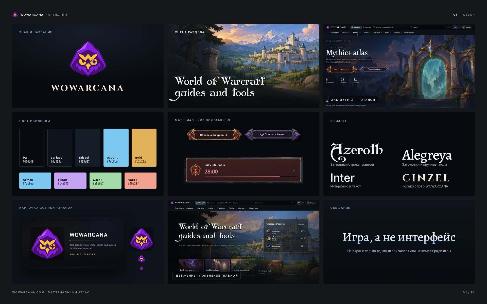
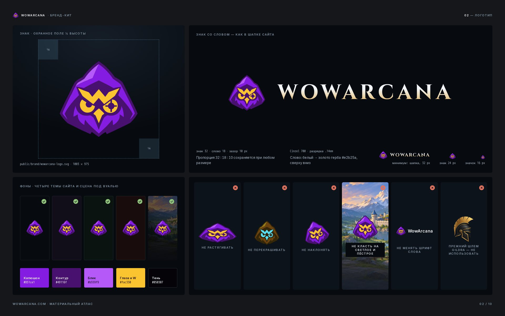
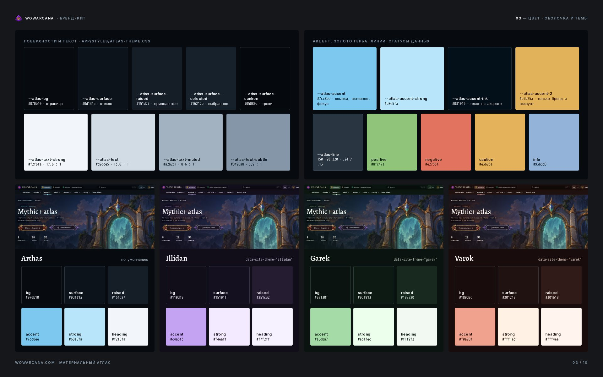
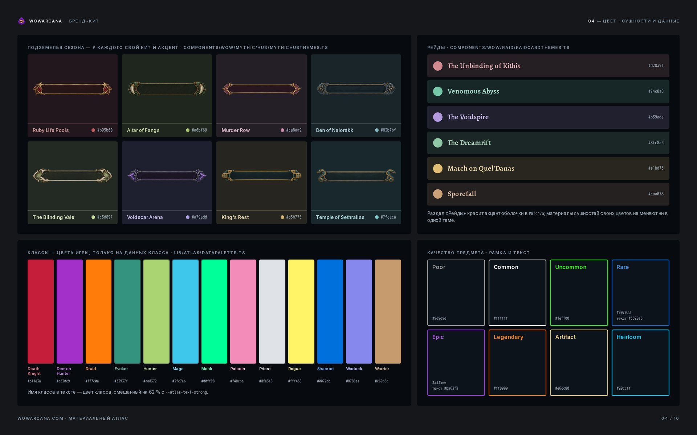
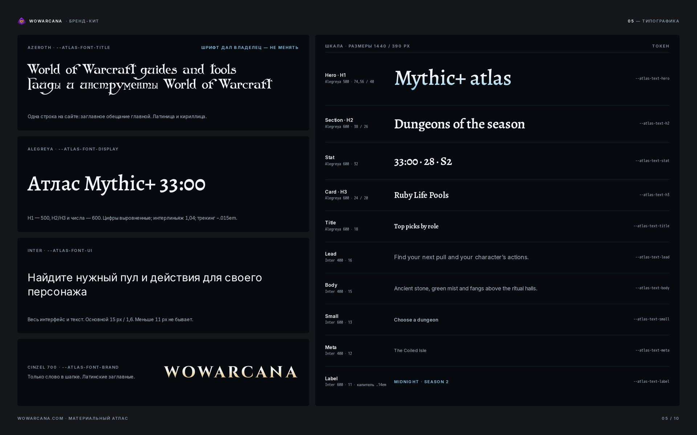
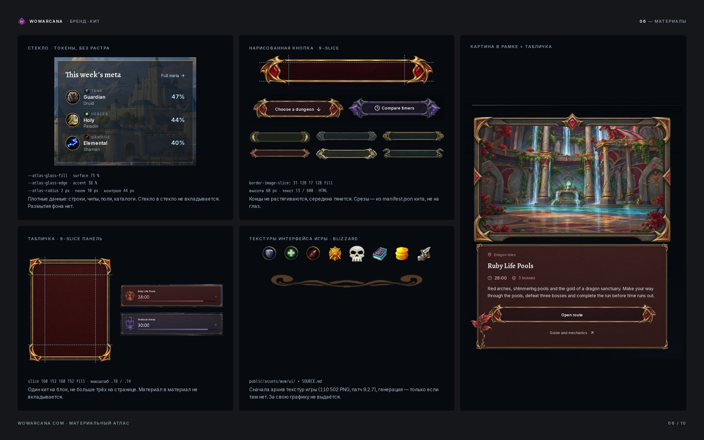
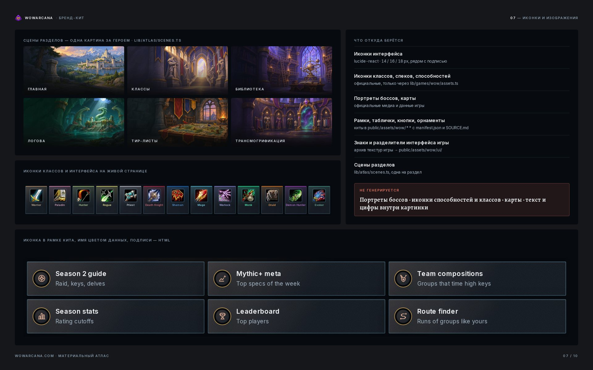
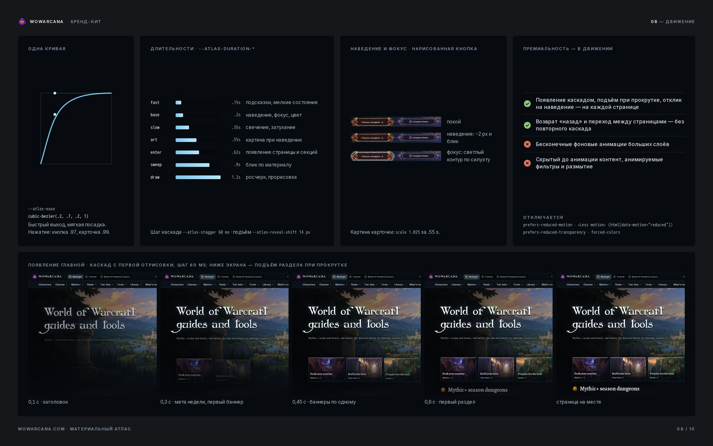
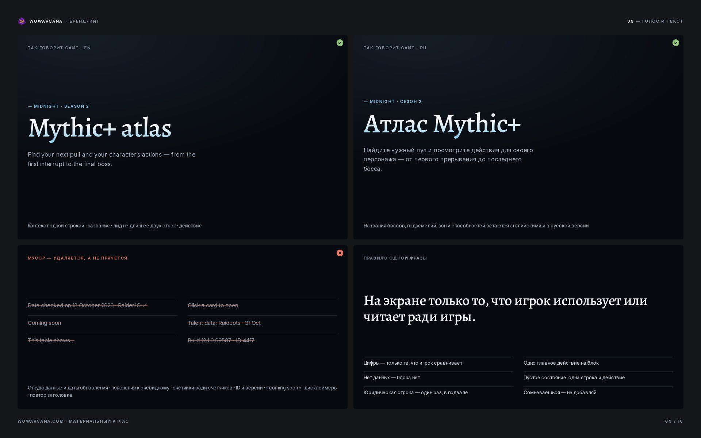
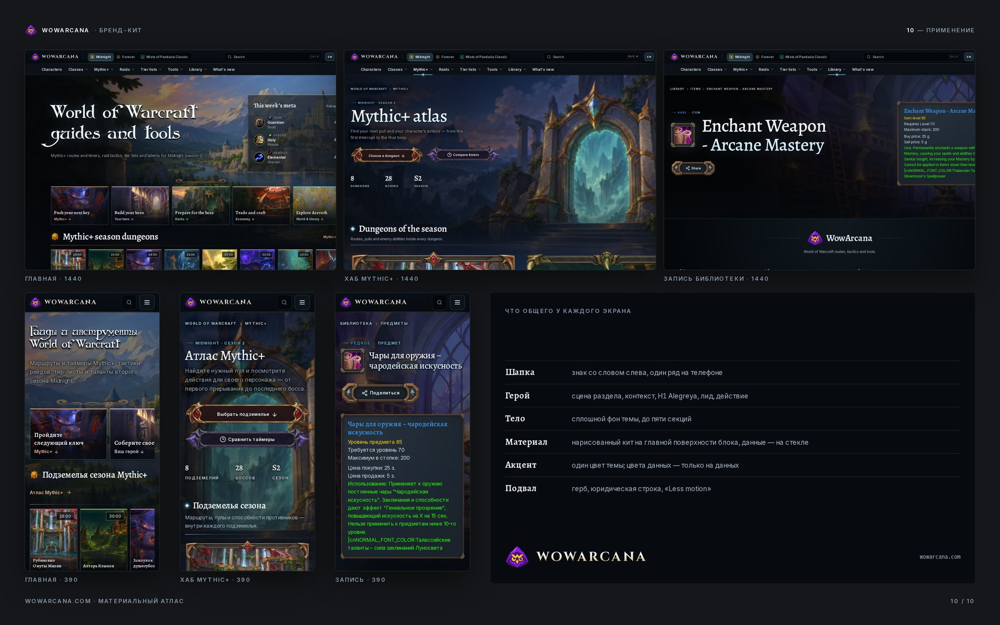

# WowArcana — бренд-кит

Собран 12 ноября 2026 из действующих файлов и токенов сайта https://wowarcana.com. Ничего не переизобретено:
логотип, палитра, шрифты и материалы — те, что уже работают. По этому документу сверяют новую страницу, картинку
или текст; при расхождении с кодом прав код, а документ правят.

Связанные документы: эталон трёх страниц — [docs/design/reference/README.md](../design/reference/README.md);
рецепты компонентов и ассетов — скилл `gildra-wow-material-design`; чистый текст — скилл `gildra-clean-ui`;
компоненты кита — [packages/atlas-ui/README.md](../../packages/atlas-ui/README.md).

Доски (превью 1920 px; полные 3840 × 2400 PNG и их HTML — `~/gildra-brandkit-20261112/boards/`):

| | | |
| --- | --- | --- |
| [Обзор](boards/01-overview.jpg) | [Логотип](boards/02-logo.jpg) | [Цвет: оболочка и темы](boards/03-colour-shell.jpg) |
| [Цвет: сущности и данные](boards/04-colour-data.jpg) | [Типографика](boards/05-typography.jpg) | [Материалы](boards/06-materials.jpg) |
| [Иконки и изображения](boards/07-icons-images.jpg) | [Движение](boards/08-motion.jpg) | [Голос и текст](boards/09-voice.jpg) |
| [Применение](boards/10-applications.jpg) | | |

## 1. Суть

WowArcana — гайды и инструменты World of Warcraft: маршруты и таймеры Mythic+, тактики рейдов, тир-листы, таланты,
библиотека. Образ — **материальный атлас**: тёмная оболочка с одним акцентом темы и нарисованные игровые материалы
(рамки, таблички, кнопки) вокруг живого HTML. Обещание интерфейса: на экране только то, что игрок читает или
нажимает ради игры.

## 2. Логотип

| Что | Файл | Где используется |
| --- | --- | --- |
| Знак (сова в капюшоне с буквой W), SVG 1003 × 975 | `apps/web/public/brand/wowarcana-logo.svg` | шапка, подвал, карточки ссылок; компонент `components/brand/GildraCrest.tsx` |
| Знак PNG 512 × 512 | `apps/web/public/brand/wowarcana-logo.png` | Organization JSON-LD, карточки ссылок |
| Значок сайта | `apps/web/app/favicon.ico`, `app/icon.png` (512), `app/apple-icon.png` (180) | вкладка браузера, домашний экран |
| Карточка ссылки 1200 × 630 | `apps/web/public/brand/og-card.png` | страницы без своей карточки |
| Знак со словом, слово отдельно, знак на тёмном поле (PNG) | [`docs/brand/logo/`](logo/) | презентации, соцсети, документы |

Происхождение: знак и значок дал владелец 9 ноября 2026 (`apps/web/public/brand/SOURCE.md`). Полный набор для
скачивания (знак 64–2048 px, знак со словом, слово, значки) — `~/gildra-brandkit-20261112/logo/`, собран скриптом
`tools/logo-pack.cjs` из SVG владельца и стилей шапки, без перерисовки.

**Знак со словом** — пара из шапки сайта (`components/platform/navigation/atlasToolbar.module.css`, `.brand`):
знак высотой 32, слово WOWARCANA 18 px, зазор 10 px; пропорция 32 : 18 : 10 сохраняется при любом размере.
Слово — Cinzel 700, заглавные, разрядка .14em, заливка сверху вниз от `--atlas-text-strong` `#f2f6fa` (30 %) к золоту
герба `--atlas-accent-2` `#e2b25a`.

**Цвета знака** (из SVG, не меняются): капюшон `#851ce1`, контур `#49116f`, блик `#b559f9`, глаза и W `#fac330`,
тень `#050307`.

| Правило | Значение |
| --- | --- |
| Охранное поле | ¼ высоты знака с каждой стороны |
| Минимальный размер | знак со словом — как в шапке (знак 32 px); знак один — 24 px; 16 px — только значок сайта |
| Узкий экран | до 340 px слово скрывается, остаётся знак |
| Фоны | фон любой из четырёх тем сайта; картина — только под тёмной вуалью |
| Наведение в шапке | знак поднимается на 1 px, свечение акцентом — других эффектов нет |

Нельзя: растягивать, перекрашивать, наклонять, класть на светлое и пёстрое без вуали, набирать слово другим
шрифтом, использовать прежний шлем Gildra (`public/brand/gildra-helmet-*`, `helmet*.png|webp` остались в
репозитории, на сайте не показываются).

Охранное поле и минимальные размеры записаны по тому, как знак стоит на сайте сегодня; отдельного решения
владельца по ним не было.

## 3. Цвет

Источник — `apps/web/app/styles/atlas-theme.css` (токены) и `app/styles/site-theme.css` (темы). В CSS компонентов
только `var(--atlas-*)`; `npm run atlas:check` не пропускает hex и названия шрифтов.

### Оболочка (тема по умолчанию)

| Токен | Значение | Роль |
| --- | --- | --- |
| `--atlas-bg` | `#070b10` | фон страницы, подложка под материалы |
| `--atlas-surface` | `#0d131a` | стеклянные панели |
| `--atlas-surface-raised` | `#151d27` | приподнятые панели |
| `--atlas-surface-selected` | `#16212b` | выбранная строка, чип |
| `--atlas-surface-sunken` | `#05080c` | треки, поля выбора |
| `--atlas-text-strong` | `#f2f6fa` | заголовки, текст на кнопках (17,6 : 1 на панели) |
| `--atlas-text` | `#d2dce5` | основной текст (13,6 : 1) |
| `--atlas-text-muted` | `#a2b2c1` | лиды, подписи (8,6 : 1) |
| `--atlas-text-subtle` | `#8496a8` | третичный текст (5,9 : 1) |
| `--atlas-accent` | `#7cc8ee` | ссылки, активное, eyebrow, фокус |
| `--atlas-accent-strong` | `#b8e5fa` | обводка фокуса, свет заголовка |
| `--atlas-accent-ink` | `#031019` | текст на акцентной заливке |
| `--atlas-accent-2` | `#e2b25a` | золото герба: только бренд и аккаунт |
| `--atlas-line` / `-soft` / `-strong` | `rgba(150,190,220,.24)` / `.13` / `rgba(124,200,238,.6)` | разделители |
| `--atlas-positive` / `negative` / `caution` / `info` | `#8fc47a` / `#e2735f` / `#e3b25a` / `#93b3d8` | только статусы данных (▲▼, предупреждения) |

### Четыре темы сайта

Тема персонажа (`html[data-site-theme]`) меняет фон и акцент оболочки. Страница обязана выглядеть правильно во
всех четырёх; материалы сущностей своих цветов не меняют.

| Тема | bg | surface | raised | accent | accent-strong | heading |
| --- | --- | --- | --- | --- | --- | --- |
| Arthas (по умолчанию) | `#070b10` | `#0d131a` | `#151d27` | `#7cc8ee` | `#b8e5fa` | `#f2f6fa` |
| Illidan | `#110d19` | `#15101f` | `#251c32` | `#c4a3f3` | `#f4eaff` | `#f7f2ff` |
| Garek | `#0a130f` | `#0d1913` | `#182a20` | `#a5dba7` | `#ebffec` | `#f1f9f2` |
| Varok | `#180d0c` | `#201210` | `#301b18` | `#f0a28f` | `#fff1e3` | `#fff4ee` |

Золото герба `#e2b25a` одно во всех темах.

### Сущности и данные

Три слоя не смешиваются: оболочка красится акцентом темы, материал сущности — её акцентом, данные — цветами игры.

| Подземелье (`lib/wow/dungeonArtDirection.ts`) | Акцент | Рейд (`components/wow/raid/raidCardThemes.ts`) | Акцент |
| --- | --- | --- | --- |
| Ruby Life Pools | `#b95b60` | The Unbinding of Kithix | `#d28a91` |
| Altar of Fangs | `#a6bf69` | Venomous Abyss | `#74c8a8` |
| Murder Row | `#ca8aa9` | The Voidspire | `#b39ade` |
| Den of Nalorakk | `#83b7bf` | The Dreamrift | `#8fc8a6` |
| The Blinding Vale | `#c3d897` | March on Quel'Danas | `#e1bd73` |
| Voidscar Arena | `#a79add` | Sporefall | `#caa078` |
| King's Rest | `#d5b775` | | |
| Temple of Sethraliss | `#7fcaca` | | |

Внутри материала цвета выводятся из акцента: свет `color-mix(акцент 65 %, --atlas-text-strong)`, подложка
`color-mix(акцент 15 %, --atlas-bg)`, линия `color-mix(акцент 30 %, transparent)`. Раздел «Рейды» красит акцент
оболочки в `#8fc47a`.

Цвета классов и качества предметов — цвета игры, только на самих данных (`lib/atlas/dataPalette.ts`):

- классы: Death Knight `#c41e3a`, Demon Hunter `#a330c9`, Druid `#ff7c0a`, Evoker `#33937f`, Hunter `#aad372`,
  Mage `#3fc7eb`, Monk `#00ff98`, Paladin `#f48cba`, Priest `#dfe3e8`, Rogue `#fff468`, Shaman `#0070dd`,
  Warlock `#8788ee`, Warrior `#c69b6d`; имя класса в тексте — цвет, смешанный на 62 % с `--atlas-text-strong`;
- качество (рамка / текст): Poor `#9d9d9d`, Common `#ffffff`, Uncommon `#1eff00`, Rare `#0070dd` / `#3590e6`,
  Epic `#a335ee` / `#ba63f3`, Legendary `#ff8000`, Artifact `#e6cc80`, Heirloom `#00ccff`.

## 4. Типографика

| Шрифт | Токен | Где |
| --- | --- | --- |
| Azeroth (кириллица и латиница) | `--atlas-font-title` | одна строка: заглавное обещание главной. Шрифт дал владелец — не заменять и не убирать. Файлы: `public/assets/wow/fonts/azeroth/` |
| Alegreya | `--atlas-font-display` | H1 (500), H2/H3 и крупные числа (600) |
| Inter | `--atlas-font-ui` | весь интерфейс и текст |
| Cinzel 700 | `--atlas-font-brand` | только слово WOWARCANA |

Подключение: `apps/web/app/root-document.tsx` (`next/font`), Azeroth — `app/styles/local-book-fonts.css`.

| Роль | Токен | Размер 1440 / 390 | Начертание |
| --- | --- | --- | --- |
| H1 героя | `--atlas-text-hero` | 74,56 / 40 px | Alegreya 500, интерлиньяж 1,04, градиент `--atlas-text-strong` 38 % → свет акцента |
| H2 секции | `--atlas-text-h2` | 38 / 26 | Alegreya 600, ромб-самоцвет перед заголовком, линия под ним |
| Число | `--atlas-text-stat` | 32 | Alegreya 600, выровненные цифры |
| H3 карточки, заголовок на табличке | `--atlas-text-h3` | 24 / 20 | Alegreya 600 |
| Заголовок на стекле | `--atlas-text-title` | 18 | Alegreya 600 |
| Лид | `--atlas-text-lead` | 16 | Inter 400, 1,6, `--atlas-text-muted`, не шире 480–520 px |
| Текст | `--atlas-text-body` | 15 | Inter 400, 1,6 |
| Кнопки, факты | `--atlas-text-small` | 13 | Inter 600 |
| Локация, вторичная ссылка | `--atlas-text-meta` | 12 | Inter |
| Eyebrow, крошки, подписи счётчиков | `--atlas-text-label` | 11 | Inter 600, капитель, разрядка .14em |

Меньше 11 px не бывает. Трекинг заголовков −.015em. Цифры — `lining-nums`, в таблицах `tabular-nums`. Текст на
нарисованном материале — с `text-shadow: 0 1px 3px var(--atlas-bg)`, на живописи — `--atlas-text-halo`.

## 5. Материалы

| Уровень | Что это | Где |
| --- | --- | --- |
| **Материал** — нарисованный кит | табличка и кнопка 9-slice, рамка картины и иконки, часы, орнамент | герой (кнопки), главная поверхность блока: карточка сущности, табличка роли, форма инструмента |
| **Стекло** — токены | `--atlas-glass-fill` (surface 75 %), `--atlas-glass-edge` (акцент 38 %), `--atlas-glass-sheen`, радиус `--atlas-radius` 2 px; поля `--atlas-radius-control` 10 px, высота контрола 44 px; размытия фона нет | плотные данные: строки, чипы, поля, каталоги |

- Один кит на блок, не больше трёх на странице. Стекло не вкладывается в стекло, материал — в материал.
- Дверь к материалам — `apps/web/components/wow/shared/materialAtlas.ts`: `MaterialPlaque`, `MaterialButton`,
  `MaterialLinkButton`, `MaterialCard`, `MaterialFrame`, `materialIconFrameStyle`. CSS другой страницы не копируют.
- Киты: 8 подземелий и 6 рейдов (акценты — раздел 3), киты разделов `public/assets/wow/slim/{characters,forever,library,talents,tier-lists}`,
  аукцион `public/assets/wow/auction/controls`, вход `public/assets/wow/characters/frost-*`. У каждого `manifest.json` и `SOURCE.md`.
- **9-slice.** Кнопка и табличка — `border-image` с `fill`; срезы берутся из `manifest.json` (кнопка Ruby Life Pools:
  768 × 132, срезы 31 128 17 128; табличка: 768 × 959, срезы 160 152 160 152, масштаб .18, на телефоне .14).
  Высота кнопки 68 px. Целиком ассет не растягивают (`background-size: 100% 100%` запрещён).
- **Рамка картины** — `object-fit: contain`, сцена `cover` в окне, измеренном по альфе рамки; на глаз окно не подбирают.
- Приглушение нарисованных слоёв одно на весь сайт: кнопки и таблички `contrast(.88) saturate(.84) brightness(.92)`,
  рамки `…brightness(.95)`, сцены в рамках `contrast(.94) saturate(.9)`.
- Текст, цифры, иконки интерфейса — только HTML. Растр — только декор: `alt=""`, `aria-hidden`, `pointer-events: none`.
- **Текстуры интерфейса игры.** Перед тем как рисовать или генерировать рамку, кнопку, панель, орнамент, разделитель или
  значок — посмотреть архив `/home/debian/wow-assets/wow-ui-textures` (110 502 PNG, патч 9.2.7; указатель
  `/home/debian/wow-assets/README.md`). Взятое кладут в `apps/web/public/assets/wow/ui/` с записью в `SOURCE.md`.
  Это графика Blizzard: за свою не выдаётся. Сейчас оттуда — знаки ролей и разделов главной, разделитель
  (`public/assets/wow/ui/home/`), текстуры аукциона и персонажа (`public/assets/wow/ui-textures/`).
- Новые нарисованные ассеты — только по скиллу `gildra-asset-imagegen`; после генерации ассет не ретушируют.

## 6. Иконки и изображения

| Что | Откуда |
| --- | --- |
| Иконки интерфейса | `lucide-react`: 14 px в строке, 16 в кнопке, 18 в плитке; рядом с подписью, `aria-hidden` |
| Иконки классов, специализаций, способностей, предметов | официальные, только через `apps/web/lib/games/wow/assets.ts` |
| Портреты боссов, карты | официальные медиа и данные игры |
| Сцена раздела (одна картина за героем) | `apps/web/lib/atlas/scenes.ts`, файлы `public/assets/wow/loading/` |
| Карточка ссылки страницы | `opengraph-image.tsx` → `lib/og` (сцена, название, знак) |

Не генерируются: портреты боссов, иконки способностей и классов, карты, текст и цифры внутри картинки. Нет
официального портрета — в слоте стоит порядковый номер. Эмодзи и декоративных глифов нет.

## 7. Движение

Владелец, 12 ноября 2026: без плавного движения сайт «не чувствуется премиальным и профессиональным».
Поэтому движение — обязательная часть страницы, а не поздняя доработка.

| Токен | Значение | Для чего |
| --- | --- | --- |
| `--atlas-ease` | `cubic-bezier(.2, .7, .2, 1)` | одна кривая на весь сайт |
| `--atlas-duration-fast` | .15s | подсказки, мелкие состояния |
| `--atlas-duration` | .2s | наведение, фокус, цвет |
| `--atlas-duration-slow` | .35s | свечение, затухание |
| `--atlas-duration-art` | .55s | картина при наведении (`scale 1.025`) |
| `--atlas-duration-enter` | .62s | появление страницы и секций |
| `--atlas-stagger` | 60 ms | шаг каскада |
| `--atlas-reveal-shift` | 14 px | подъём при появлении |
| `--atlas-duration-sweep` | .9s | блик по материалу |
| `--atlas-duration-draw` | 1.2s | росчерк, прорисовка |
| `--atlas-press-scale` / `-card` | .97 / .99 | нажатие кнопки / карточки |

Что есть на каждой странице:

1. **Появление.** При первой загрузке блок заголовка приходит каскадом: крошки → eyebrow → H1 → лид → кнопки →
   счётчики, шаг 60 ms, подъём 14 px, .62s. Это CSS, работает с первой отрисовки. Общая реализация —
   `packages/atlas-ui/src/AtlasHero.module.css` (`atlas-hero-rise`) и `AtlasArrival.tsx`; главная и хабы Mythic+
   и рейдов держат своё появление (`components/wow/home/HomeMotion.tsx`, `MythicHubMotion.tsx`, `RaidHubMotion.tsx`).
2. **Прокрутка.** Секция ниже первого экрана поднимается один раз, когда до неё дошли (`AtlasArrival`,
   IntersectionObserver); росчерк под заголовком секции и карточки — `animation-timeline: view()`.
   До анимации ничего не скрыто: без JS страница читается целиком.
3. **Наведение и фокус.** Кнопка: −2 px и блик; картина карточки: `scale 1.025`; фокус — светлый контур по
   силуэту рисунка, у стекла `outline 2px`.
4. **Переход между страницами** ведёт один `RouteTransitionRuntime`; страница, открытая переходом или кнопкой
   «назад», своё появление не повторяет.

Запрещено: бесконечные фоновые анимации больших слоёв (правило `AtlasFrame` от 23 октября 2026 — прокрутка
тормозила); контент, скрытый до анимации; анимируемые фильтры и размытие; свой темп мимо токенов.
Малые петли сцены (искры, дождь, свет портала на хабах) допустимы и ставятся на паузу вне экрана.

Каждый эффект отключается: `prefers-reduced-motion`, переключатель «Less motion» в подвале
(`html[data-motion="reduced"]`, `[data-ui-motion="reduce"]`), `prefers-reduced-transparency`
(`[data-transparency="reduced"]`), `forced-colors`. Шаблон отключения — `gildra-wow-material-design/design.md` §5.

## 8. Голос и текст

Правило одной фразы: на экране только то, что игрок использует или читает ради игры. Полные правила и аудит —
скилл `gildra-clean-ui` (`node ~/.claude/skills/gildra-clean-ui/scripts/clean-ui-audit.cjs <url>`).

- Герой: контекст одной строкой (eyebrow: сезон, тип записи), название, лид не длиннее двух строк, одно главное действие.
- Названия боссов, подземелий, зон, способностей и предметов остаются английскими и в русской версии.
- Цифры — только те, что игрок сравнивает: ключи, время, доля, уровень предмета.
- Нет данных — блок не выводится. Пустое состояние: одна строка и действие.
- Юридическая строка — один раз, в подвале.
- Убирается, а не прячется: откуда данные и даты обновления, пояснения к очевидному, счётчики ради счётчиков, ID и
  версии, «coming soon», дисклеймеры по секциям, повтор заголовка, плашки «источники» и «назад к…».
- Тексты лежат в `*Copy.ts` рядом с компонентом, на двух языках.

## 9. Применение

Каждый экран собран одинаково: шапка со знаком и словом → герой на сцене раздела → сплошное тело темы, до пяти
секций → подвал с гербом и юридической строкой. Порядок сборки: `AtlasFrame` → `AtlasHero` → `AtlasSection`.
Эталон — `/wow/mythic-plus`, `/wow/mythic-plus/meta`, `/wow/raids`; их вид не меняют, остальные страницы
подтягивают к ним. Правка общих файлов проверяется `npm run design:lock -- --base <адрес кандидата>`.

## 10. Что не решено

Список расхождений сайта с китом на 12 ноября 2026, со снимками: `~/gildra-brandkit-20261112/DIVERGENCES.md`.
Решения, которые меняют вид бренда, остаются за владельцем:

1. Слово WOWARCANA набрано по-разному: в шапке — Cinzel 700 с переходом в золото; в подвале — «WowArcana» Alegreya;
   в карточках ссылок страниц — Alegreya (`lib/og/atlasOg.tsx`); в общей карточке сайта `og-card.png` — рубленый шрифт,
   знак стоит на чёрной плашке, подпись «Midnight · Season 1» устарела (на сайте сезон 2). Вариант карточки со словом
   из шапки и без плашки — `~/gildra-brandkit-20261112/logo/proposals/link-card-proposed-1200x630.png`.
2. Знак фиолетово-золотой, оболочка по умолчанию ледяная: связь держит золото `#e2b25a`. Цвета знака в палитру
   оболочки не входят.
3. Одноцветного знака и знака для светлого фона нет.
4. Компактный герой рабочих страниц сегодня четырёх размеров (60, 58,9, 45, 38 px) — нужен один.
5. Лаборатория ротаций (`/wow/rotation/<spec>`) живёт на прежней янтарной палитре: 276 цветов и 94 размера текста
   мимо токенов в `components/platform/rotation/rotationLab.module.css`.
6. Страница историй (`/ru/wow/stories`, только на русском) — отдельная книжная сцена во фрейме
   (`apps/web/public/story-library/`): живёт вне токенов и кита.
