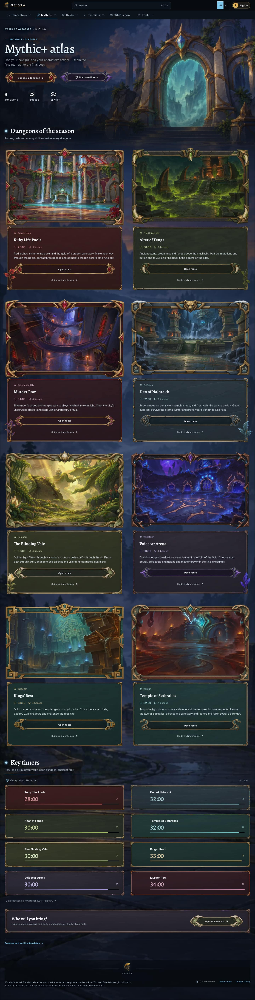
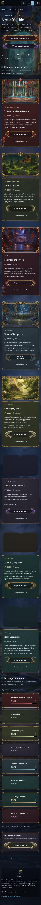
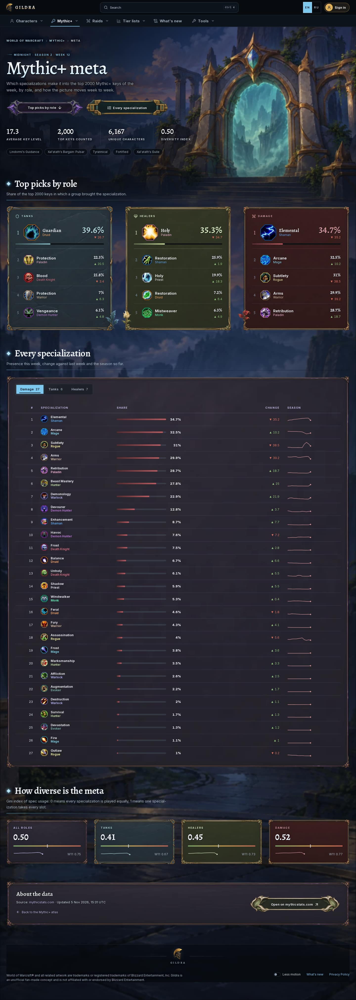
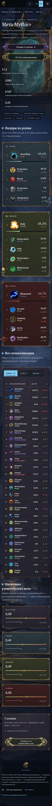
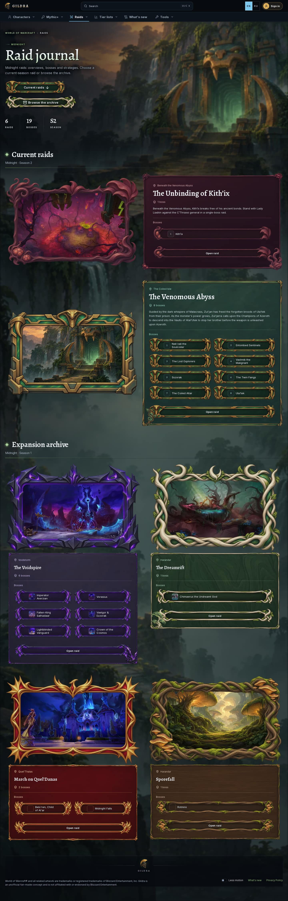
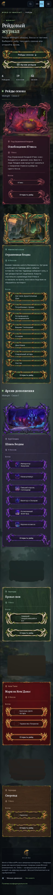

# Эталон дизайна Gildra — Mythic+, мета, рейды (зафиксирован 2026-11-05)

Решение владельца: дизайн трёх страниц — образец для всего gildra.net.

| Страница | URL |
| --- | --- |
| Хаб Mythic+ | https://gildra.net/wow/mythic-plus |
| Мета Mythic+ | https://gildra.net/wow/mythic-plus/meta |
| Рейдовый журнал | https://gildra.net/wow/raids |

**Правила для людей и ИИ-агентов (Claude, Codex):**

1. Эти страницы не меняют ради других. Другие страницы подтягивают к ним.
2. Новая страница собирается из тех же компонентов и токенов (раздел «Из чего собрано»). Своих стилей, цветов и шрифтов у разделов нет.
3. Правка общих файлов (`packages/atlas-ui`, `components/wow/shared/material*`, `app/styles/atlas-theme.css`, `site-theme.css`,
   оболочка `AtlasFrame`/навигация) проверяется `npm run design:lock -- --base <кандидат>` — эталон не должен сдвинуться.
4. Переснять эталон (`--capture`) можно только по прямому решению владельца; новые файлы заменяют эти, дата — в заголовке.
5. Полные рецепты компонентов, ассеты и правила текста — скилл `gildra-wow-material-design` (`~/.claude/skills/…`, `~/.codex/skills/…`);
   при расхождении со скиллом прав этот документ и код.

## Снимки

Полные страницы, 1440 EN и 390 RU (reduced motion, cookie отклонены): [`shots/`](shots/).

| | 1440 EN | 390 RU |
| --- | --- | --- |
| Mythic+ |  |  |
| Мета |  |  |
| Рейды |  |  |

Блоки крупно: [`parts/`](parts/) — герой, карточка подземелья, таймеры, роли меты, таблица, индекс разнообразия, текущие рейды,
архив, кнопка в покое/наведении/фокусе, герой в темах illidan/garek/varok.

## Язык оформления — «материальный атлас»

Тёмная оболочка с акцентом темы + **нарисованные материалы** (рамки картин, таблички, кнопки 9-slice, песочные часы, ростки)
вокруг **живого HTML**. Текст, цифры, иконки интерфейса — только HTML. Растр — только декор (`alt=""`, `aria-hidden`,
`pointer-events: none`). У каждой сущности (подземелье, рейд, роль) свой кит материала и свой акцент.

### Токены (из `app/styles/atlas-theme.css`; в CSS только `var(--atlas-*)`)

| Что | Значение |
| --- | --- |
| Фон / поверхность / приподнятая | `--atlas-bg #070b10` · `--atlas-surface #0d131a` · `--atlas-surface-raised #151d27` |
| Текст | strong `#f2f6fa` · text `#d2dce5` · muted `#a2b2c1` · subtle `#8496a8` |
| Акцент темы | `--atlas-accent #7cc8ee` (strong `#b8e5fa`); рейды перекрашивают акцент раздела в `#8fc47a`; темы illidan/garek/varok меняют только акцент |
| Статусы данных | positive `#8fc47a` · negative `#e2735f` · caution `#e3b25a` · info `#93b3d8` — только для ▲/▼ и предупреждений |
| Шрифты | `--atlas-font-display` Alegreya (H1 500, H2/H3/цифры 600) · `--atlas-font-ui` Inter |
| Шкала | hero clamp(40→74.56 px) · h2 clamp(26→38) · h3 clamp(20→24) · stat 32 · lead 16 · body 15 · small 13 · meta 12 · label 11 капитель .14em |
| Интерлиньяж | tight 1.04 · snug 1.25 · body 1.6 |
| Сетка | контейнер 1540 · gutter clamp(14–26) · шаг 4/8/12/16/24/32/48/72 · радиус стекла 2, полей 10 · контрол 44 |
| Шапка | sticky, `--atlas-bg`, 108 px (два ряда) на десктопе, 57 px (бургер) на телефоне |
| Движение | ease `cubic-bezier(.2,.7,.2,1)` · fast .15s · enter .62s · art .55s; всё выключается reduced motion / «Less motion» / reduced transparency / forced colors |

Полный замер (190 токенов, типографика, кнопки, шапка, ассеты на 12 прогонах): [`design-lock.json`](design-lock.json).

### Анатомия

**Герой (все три страницы).** Картина сцены справа на всю высоту первого экрана, левая колонка 805 px:
крошки (капитель 11, акцент) → eyebrow «— Midnight · Season 2» (капитель, акцент, черта слева) → H1 Alegreya 74.56/500
с градиентом `--atlas-text-strong → акцент` → лид 16 px muted, ≤480 px (мета 520) → 1–2 нарисованные кнопки 68 px →
счётчики `AtlasStats` (цифра Alegreya + капитель-подпись, разделители-линии). На 390: кнопки во всю колонку (362 px) друг под другом.

**Шапка секции.** Ромб-самоцвет в акценте + H2 38/26 px + подзаголовок Inter 15 muted + линия на всю ширину.

**Mythic+.** Сетка 2 × 678 px, gap 48/32 (390: 1 колонка, gap 48): карточка = картина в рамке подземелья 678×452
над табличкой (локация 12 px с иконкой, H3 24/20, время Alegreya в цвете кита + боссы, описание 15 px, кнопка кита во всю ширину,
«Guide and mechanics ↗»), росток из нижнего угла. Таймеры: 8 табличек 2 × 678 высотой 145 — часы кита, название, время
Alegreya 32 в цвете кита, полоса = время / максимум. CTA-табличка во всю ширину, затем `<details>` источников.

**Мета.** Герой + 4 счётчика + чипы аффиксов. Роли: 3 × 431, gap 48 — рамка в ките роли, №1 крупно (медальон 60, % 38),
ещё 4 строки (иконка 40, % 18, ▲/▼); росток роли живёт в боковом поле таблички и не заходит на строки. Таблица всех
специализаций в рамке с вкладками ролей. Индекс разнообразия: 4 × 329, gap 24. Табличка «About the data».

**Рейды.** Текущие: картина и табличка рядом (671/705, gap 12), чипы боссов 2 колонки на кнопочном ките рейда.
Архив: 2 × 678, картина над табличкой. У чипа — портрет из журнала 32 px, а без официального портрета — порядковый номер
в том же слоте (портреты не генерируются). Под заголовком таблички — локация.

**Фокус.** Нарисованные кнопки показывают фокус светлым контуром по силуэту рисунка (`drop-shadow` на слое материала),
в forced colors — системный контур. Ссылки и стекло — `outline: 2px` светлым акцентом с отступом 2–4 px.

**Подвал.** Подложка в ширину контейнера, герб по центру, юридическая строка слева, «Less motion · What's new · Privacy» справа.

### Из чего собрано

| Блок | Код (`apps/web/`) |
| --- | --- |
| Оболочка страницы, герой, секция, счётчики | `@gildra/atlas-ui` `AtlasFrame` / `AtlasHero` / `AtlasSection` / `AtlasStats` |
| Хаб Mythic+, карточки, таймеры, ростки | `components/wow/mythic/MythicAtlasPage.tsx`, `DungeonCardGrid.tsx`, `PaintedCard.tsx`, `MythicHubTimers.tsx`, `hub/MythicHubOrnaments.tsx` |
| Мета | `components/wow/mythicMeta/MythicMetaPage.tsx`, `MetaParts.tsx` |
| Рейды | `components/wow/raid/RaidAtlasPage.tsx`, `RaidHubCards.tsx`, `raidHubData.ts`, `raidCardThemes.ts` |
| Общие табличка / кнопка / рамка иконки | `components/wow/shared/materialAtlas.ts`, `components/wow/shared/material/*` |
| Киты и акценты | `lib/wow/dungeonArtDirection.ts`, `components/wow/mythic/hub/mythicHubThemes.ts`, `components/wow/raid/raidCardThemes.ts` |

## Нельзя

- Мусорный текст: «откуда данные», пояснения к очевидному, повторы, счётчики ради счётчиков, служебные слова — правила и аудит в `.claude/skills/gildra-clean-ui/`.

- Хардкодить hex в компонентах (кроме таблиц тем сущностей) и шрифты вне двух токенов.
- Растягивать нарисованные ассеты целиком: кнопки и панели — `border-image` 9-slice с `fill`, рамки — `object-fit: contain`.
- Ретушировать, перекрашивать, генерировать портреты боссов, иконки способностей и карты.
- Показывать QA-текст, ID, номера сборок, заглушки; полуоформленные карточки в одном списке.
- Класть декор поверх данных (числа, ранги, дельты должны быть видны целиком).

## Проверка

```bash
npm run design:lock                                   # прод против эталона (≈2 мин)
npm run design:lock -- --base http://127.0.0.1:<port> # кандидат
npm run visual:diff -- --routes /wow/mythic-plus,/wow/mythic-plus/meta,/wow/raids   # попиксельно
```

`design:lock` сравнивает токены, шрифты, цвета, размеры кнопок и шапки, наличие нарисованных ассетов, HTTP 200, ошибки
консоли и горизонтальный скролл на 1440/390 × EN/RU. Тексты, цифры и координаты не сравниваются — данные меняются еженедельно.
