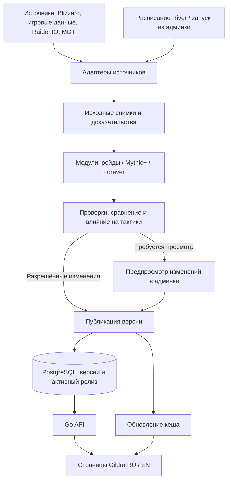

# Автообновление игровых данных Gildra

Проект от 21 октября 2026 года. Статус: архитектурное предложение для реализации.

## Решение

Создать **Gildra Data Hub**: общий механизм сбора, проверки и публикации игровых данных. Первые модули обслуживают `/ru/wow/raids` и `/ru/wow/mythic-plus`, их английские версии и вложенные страницы. Следующее расширение — отдельные модули WoW: Forever с тем же механизмом управления.

Инструмент должен самостоятельно находить изменения в разрешённых источниках, получать новые данные, проверять их и публиковать разрешённые типы изменений. Рабочая версия сайта продолжает читать последний успешно опубликованный набор, если очередное обновление не прошло проверку.

Данные и правила конкретной игры находятся в модулях. Расписание, история запусков, версии, проверка прав и механизм публикации общие. Обновление уже поддерживаемых данных не требует пересборки сайта.

Это проект системы: в рамках этой работы подготовлены документы, изучены исходники и прочитаны публичные страницы. Фоновые задания, записи в прикладные базы и публикация на сайте не выполнялись.

## Что проверено в существующем проекте

На дату проверки обе публичные страницы отвечают HTTP 200. Рейдовый журнал показывает 5 рейдов и 18 боссов. Mythic+ показывает 8 подземелий, 28 боссов, таймеры и отдельное предупреждение о черновом статусе маршрутов.

В изученной рабочей копии `50e4b0d1df08bfb6d4f6a6a7be8e5c3754bc8f01`:

- Рейды собираются из `content-manifest.json`, `midnightRaidData.ts`, публикации способностей и дополнительных данных. Текущий рейд, сезон и часть проверок количества боссов зафиксированы в компонентах.
- Mythic+ читает `dungeonRoutes.ts`, JSON с медиа и `mythicVerification.ts`. Таймеры и даты проверок включены в сборку.
- Есть серверная точка доступа `apps/web/lib/data/wow.ts`, пакет `@gildra/game-data`, контракты полноты и скрипты проверки журнала, способностей, эффектов, NPC и медиа.
- Уже есть Go API, PostgreSQL, очередь River и Python worker для других наборов данных. Их подход к фоновым обновлениям можно использовать повторно.
- Существующие таблицы `dataset_*` содержат обязательные поля для специализаций и ограничения, ориентированные на tier lists. Новый контент получает собственные таблицы; действующие наборы данных сохраняют свои контракты.

Совпадение всех исследованных файлов с действующим образом сайта в этой работе не проверялось. Проверенные пути, строки и источники перечислены в [EVIDENCE.md](EVIDENCE.md).

## Какие данные обновляются

| Область | Автоматический сбор и проверка | Публикация |
|---|---|---|
| Рейды | Список рейдов и боссов, игровые ID, локализованные имена, журнал, привязки способностей, сложности, доступные портреты | Разрешённые изменения фактов — автоматически; новая структура и спорные данные — через просмотр |
| Mythic+ | Состав сезона, ID подземелий и боссов, таймеры, источники NPC/способностей, версии карт, координаты и силы противника при наличии подходящего источника | По правилам модуля; новые карты и изменения соответствий требуют проверки |
| Изменения игры | Официальные новости, hotfixes, новые сборки, изменения выбранных исходных наборов | Факты или предложения об изменениях; связанная тактика получает статус повторной проверки |
| Тактики и маршруты | Поиск затронутых фрагментов, подготовка списка изменений и черновика правок | Проверка редактором; подтверждение прохождения в игре хранится отдельно |
| Медиа | Точное соответствие ID → изображение/иконка, доступность и хеш файла | Только подтверждённые соответствия; неизвестный портрет остаётся неизвестным |
| WoW: Forever | Собственные источники, сборки, рейды, подземелья и этапы открытия | Отдельный контекст и правила; подключение по мере появления подтверждённых данных |

На первом этапе добыча, рейтинги, аукцион и симуляции не входят в объём. Позже их можно добавить отдельными модулями. Обновление фактов не должно автоматически объявлять авторский маршрут проверенным в игре.

## Как работает система



Начальная реализация использует существующие Go jobs/API, PostgreSQL и Python worker. Код нормализации, проверки, сравнения и публикации оформляется как модули, развёртываемые вместе с соответствующими существующими процессами. Получение данных происходит в фоне, вне пользовательского запроса страницы.

### Два вида модулей

**Адаптер источника** знает способ получения данных: Blizzard API, таблицы клиента, JSON Raider.IO, конкретная версия MDT или разрешённая страница. Он сохраняет исходный ответ с версией, временем и хешем. Он не решает, что увидит пользователь сайта.

**Предметный модуль** знает устройство раздела: рейды, боссы, механики, подземелья, таймеры или маршруты. Он выбирает нужные исходные данные, проверяет связи и формирует готовый контракт для страниц. Правила публикации принадлежат ему.

Один адаптер может обслуживать несколько модулей; несколько адаптеров могут подтверждать разные поля одного модуля. Подключение новой игры не требует копирования очереди, истории и админки.

## Контекст версии игры

Каждый набор явно указывает:

```text
game: wow
edition: retail | forever
channel: live | beta | ptr
progression: season | phase | none
progressionId: идентификатор сезона/этапа либо null
region: global | eu | us | ...
```

Точный build, patch и версии источников фиксируются в снимках. Сезон retail не является обязательной моделью для Forever. Локаль — свойство текста; она не заменяет регион доступности контента. Ссылки страниц хранятся отдельно от идентичности сущностей.

**Нельзя соединять записи по одному названию, числовому ID или совпадающему slug.** Проверяются версия игры, контекст источника, тип ID и принадлежность к объекту. Одинаковые числовые ID в retail и Forever допустимы и не обозначают одну сущность. История версии одной сущности связывается отдельным стабильным ключом.

В текущем manifest уже есть модель `edition`, но `forever` среди изученных записей отсутствует. Её нужно расширить и согласовать с существующими UUID/ID, сохранив адреса опубликованных страниц.

### WoW: Forever

Пользователь уточнил, что речь об отдельной игре Blizzard и будущем сайте с аналогичными разделами. [Официальный обзор Blizzard](https://news.blizzard.com/en-us/article/24303862/world-of-warcraft-forever-whats-next-panel-recap) подтверждает самостоятельное развитие Forever, подземелья и рейды. Указанное время запуска — 4 ноября 2026 года, 15:00 PST, то есть 5 ноября, 00:00 в Варшаве. В обзоре отдельно указано открытие новых рейдов 9 декабря.

Регистрируются будущие модули `forever.raids` и `forever.dungeons`. Возможность `mythicPlus` имеет значение `unknown`, пока конкретная система и источники не подтверждены. Если она появляется, подключается `forever.mythic-plus`; если подземелья устроены иначе, используется свой модуль. Общие шаблоны страниц отображают только возможности, заявленные модулем. Адреса и домен будущего сайта остаются конфигурацией доставки.

## Откуда брать данные

| Источник | Назначение | Ограничение проектного решения |
|---|---|---|
| Официальные страницы Blizzard | Состав и открытие контента, официальные изменения, локализованные названия | Новость подтверждает конкретные сведения, а не весь гайд |
| Blizzard Game Data API | Поддерживаемые игровые ID, журнал и медиа | Возможности и namespace проверяются отдельно для каждой edition; покрытие Forever пока не исследовано |
| Таблицы клиента / закреплённые выгрузки | Деревья журнала, связи spell/NPC, эффекты, различия сложностей | Требуются точная сборка, локаль и допустимый способ использования; непонятные токены не публикуются как готовый текст |
| Raider.IO | Состав сезона и таймеры там, где есть подходящий набор | Явное сопоставление сезона, edition и ID; ответ HTTP 200 сам по себе недостаточен |
| MDT | Модель подземелья, этажи, точки NPC, patrols и enemy forces | Закрепляются commit, версия карт и допустимые условия использования; координаты не подтверждают оптимальность маршрута |
| Редакторские и экспертные материалы | Объяснения механик, приоритеты и тактика | Хранятся отдельно от импортируемых фактов; изменения сначала становятся предложениями |

Приоритет источников выбирается для конкретного поля. Например, официальный hotfix может быть новее выгрузки клиента; старая таблица не должна отменять его. Разногласие источников создаёт конфликт с объяснением. Новый HTTP-запрос не делает старую исходную информацию свежей.

## Проверка и автопубликация

Сначала для каждого модуля действует режим **«собирать и показывать изменения»**. После приёмки включается автопубликация явно разрешённых полей.

| Изменение | Начальная политика после включения автоматики |
|---|---|
| Повторная проверка того же содержимого | Обновить результат проверки источника, сохранить прежнюю версию данных |
| Имя/описание из закреплённого надёжного источника, точное соответствие сущности | Автоматически при прохождении проверки локалей и текста |
| Таймер существующего подземелья | Автоматически только по настроенному правилу источников, диапазона и допустимого изменения; обновить зависимые расчёты, отметить маршрут для сверки |
| Новый сезон, текущий рейд, новый босс, замена ID, удаление, новая карта | Просмотр и подтверждение редактором |
| Механика, значение эффекта, различие сложности, привязка NPC/spell | Просмотр на первом этапе; автоматика расширяется отдельно после доказанной корректности |
| Авторская тактика, оптимальный маршрут, проценты без полной модели | Черновик и проверка; подтверждение в игре требует собственной записи |
| Несовместимые сборки, неоднозначная сущность, частичный источник | Кандидат отклоняется либо спорный необязательный блок удерживается по явному контракту |

Проверяются схема, полнота конкретного набора, внешние ключи, различия сложностей, локали, доступность обязательных медиа, отсутствие неразрешённых шаблонов в тексте и регрессии относительно опубликованной версии. Числа 5 рейдов, 18 боссов и 8 подземелий описывают сегодняшнюю выдачу; они не становятся постоянными проверками системы.

Новые данные состоят из неизменяемого снимка и отчёта проверок. Публикация в одной транзакции переключает активный релиз на проверенную комбинацию снимков. Откат выбирает прежнюю комбинацию новой записью публикации. Исходные снимки и история сохраняются.

## Сохранение редакторской работы

Импортируемые факты, редакторские пояснения и пользовательские назначения имеют разных владельцев. Обновление источника не перезаписывает ручную корректировку. У правки сохраняются автор, причина, основание, версия и срок повторной проверки.

Тактика и маршрут ссылаются на конкретные факты и версии карт. Если изменилась связанная механика, система создаёт задачу пересмотра. При потере совместимости такой блок не отображается как действующая проверенная рекомендация. Независимые правки названия или изображения не должны понижать статус всего маршрута.

Даты различаются: получение ответа, дата самого источника, проверка факта, редакторская проверка и подтверждение в игре. Перезапуск задания, деплой или ответ 304 не обновляют дату проверки в игре.

## Админка

В существующем административном интерфейсе появляется раздел «Данные игры»:

1. **Обзор:** модуль, игра, сезон/этап, активная версия, последняя проверка, последнее изменение, состояние источников.
2. **Кандидат:** «было → стало», источник каждого поля, проверки, затронутые страницы и тактики, предпросмотр RU/EN.
3. **Действия:** обновить сейчас, повторить неудачный запуск, одобрить/отклонить кандидат, приостановить модуль, откатить публикацию.
4. **История:** запуски, версии, причины решений и редакторские изменения.

Действие «обновить» быстро ставит задачу в очередь и возвращает её ID. Права проверяет сервер публикации; публичный сайт получает только чтение. Конкретный переход из CMS к Go API проектируется через серверный адаптер существующих ролей. Предположение, что токен Payload автоматически подходит Go API, недопустимо.

## Расписание и наблюдение

Стартовые настройки, уточняемые после замеров:

| Набор | Частота |
|---|---|
| Официальные изменения и новости | Каждый час с условными запросами, если источник их поддерживает |
| Метаданные текущего контента, поддерживаемые API и таймеры | Каждые 6 часов |
| Выгрузки клиента | Проверка доступной версии каждые 6 часов; тяжёлый импорт при изменении закреплённого набора |
| MDT | Проверка выбранного канала обновлений каждые 12 часов; импорт конкретного commit |
| Архив | Раз в неделю либо по событию, затрагивающему архив |

Расписание и ключ дедупликации используют точное время UTC, edition, channel, модуль и контекст. Почасовые задания нельзя дедуплицировать одним календарным днём. Ограничиваются параллелизм, размер ответов, длительность и бюджет конкретного источника. Платный сбор требует существующего разрешённого профиля и бюджета.

Админка показывает ошибки, конфликты, реальную давность источников и покрытие. Предупреждение создаётся при пропуске двух ожидаемых проверок или истечении собственного срока пригодности источника. Повторяющаяся неизменная ошибка не порождает бесконечные одинаковые события. Канал уведомлений настраивается при реализации.

## Изменение существующих страниц

1. Сохранить изученные наборы, статусы, точные источники и ручные правки как начальный снимок. Предварительно включить результаты текущих параллельных задач по рейдам и Mythic+.
2. Добавить runtime-чтение в `lib/data` и вернуть DTO, совместимые с нынешними компонентами.
3. Перевести каталог и вложенные страницы на одну закреплённую версию данных за запрос; удалить привязку текущего рейда, S2 и таймеров к исходному коду.
4. Перенести маршруты и тактики отдельным слоем, сохранив черновые статусы и точные связи с картами/механиками.
5. Сравнить старую и новую выдачу RU/EN на стенде и включить чтение опубликованных версий.
6. Включить сбор, затем просмотр кандидатов, затем разрешённую автопубликацию.

При недоступности API используется совместимый кеш последней опубликованной версии. Если его нет, страница показывает доступное состояние отсутствия данных. Возврат к набору другой игры, сезона или к демонстрационным значениям запрещён контрактом доставки.

Цель кеширования — видимость нового релиза на страницах не позднее 5 минут в штатном режиме. Событие сброса кеша сохраняется вместе с публикацией и повторяется до обработки; короткое время кеша активного указателя обеспечивает восстановление при потере события.

## Решения о границах модулей

Предметные правила и редакторская оценка — изменчивая часть продукта. Сбор, очередь и хранение — обслуживающие механизмы. На первом этапе предполагается одна команда; при появлении отдельных владельцев сохраняются те же внешние контракты.

| Связь | Передаваемое знание / сила связи | Дистанция | Изменчивость | Решение |
|---|---|---|---|---|
| Внешний источник → адаптер | Детали чужой схемы, сильная | Внешняя система, высокая | Высокая | Все детали локализованы в одном адаптере |
| Адаптер → предметный модуль | Версионированный снимок и доказательства, контракт | Разные процессы, высокая | Высокая | Явная схема и проверки совместимости |
| Нормализация ↔ проверки рейдов/M+ | Общие игровые правила, модель/функциональная | Один модуль, низкая | Высокая | Развиваются рядом, без сетевых границ между правилами |
| Предметный модуль → публикация | Валидированный кандидат, контракт | Внутри Go, низкая | Умеренная | Выделяется по отдельному владению состоянием; прагматичная локальная граница |
| Публикация ↔ история/указатель | Транзакционные инварианты, сильная | Один компонент и одна БД, низкая | Низкая | Единый владелец атомарной публикации |
| Go API → frontend/CMS | DTO и команды, контракт | Сеть/разные приложения, высокая | Умеренная | Внутренние таблицы и модели не раскрываются |

Проверка модульности: наиболее изменчивые внешние схемы изолированы, правила, которые должны меняться вместе, находятся рядом. Осознанный компромисс — два языка сборщиков и существующие JS-проверки; во время перехода они вызываются как закреплённые инструменты и не дублируются без необходимости.

## Что нужно установить до реализации соответствующего этапа

- Доступность и покрытие источников Forever; API namespace, сборка, модели сложности и этапы открытия.
- Сопоставление текущих идентификаторов, итогов параллельного ревью и первоначального снимка.
- Допустимые пороги автоматической публикации таймеров, текстов и медиа; начальные безопасные значения описаны в контракте.
- Объём исходных ответов, реальные квоты источников и соответствующее хранение/retention.
- Интеграция действующих staff-ролей CMS с новым серверным контроллером.

Это задачи реализации и проверки источников; они не мешают подготовить ядро и первые retail-модули.

## Следующие документы

- [Контракты, модель данных и атомарная публикация](CONTRACTS.md)
- [Ответственность и устройство модулей](MODULES.md)
- [План реализации и сценарии приёмки](IMPLEMENTATION.md)
- [Проверенные источники и границы исследования](EVIDENCE.md)
